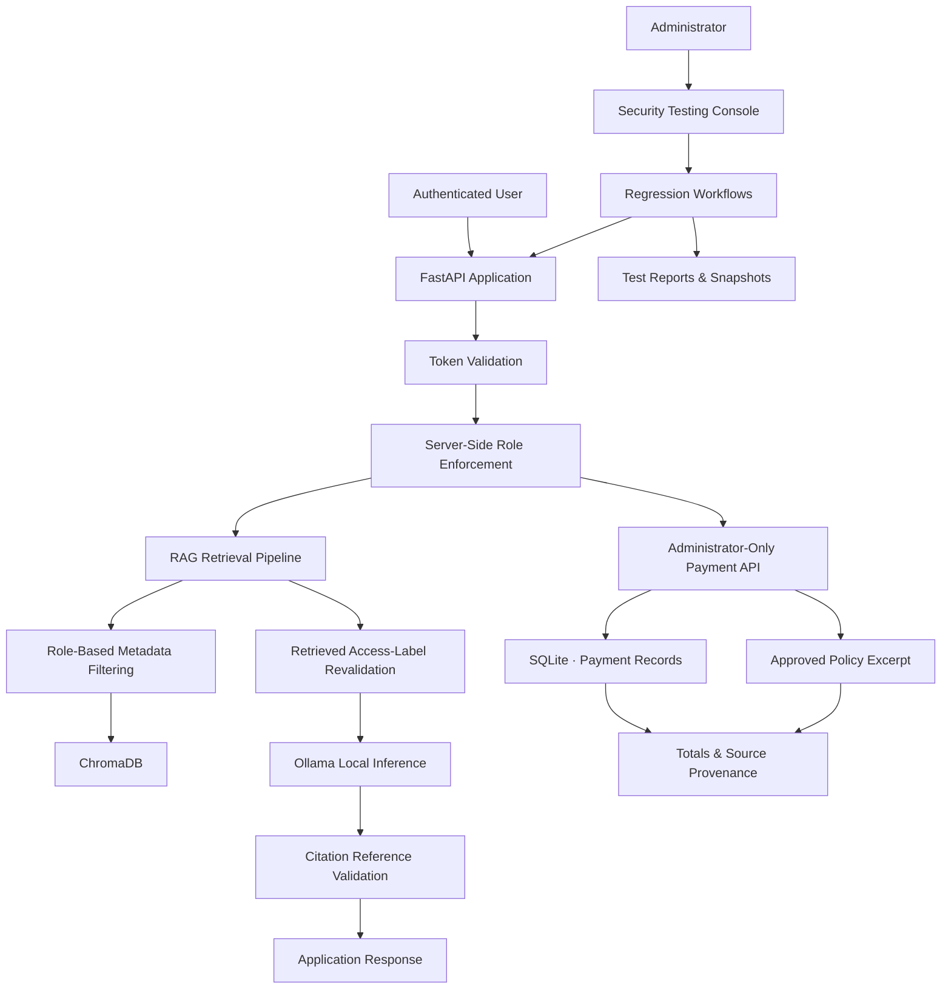
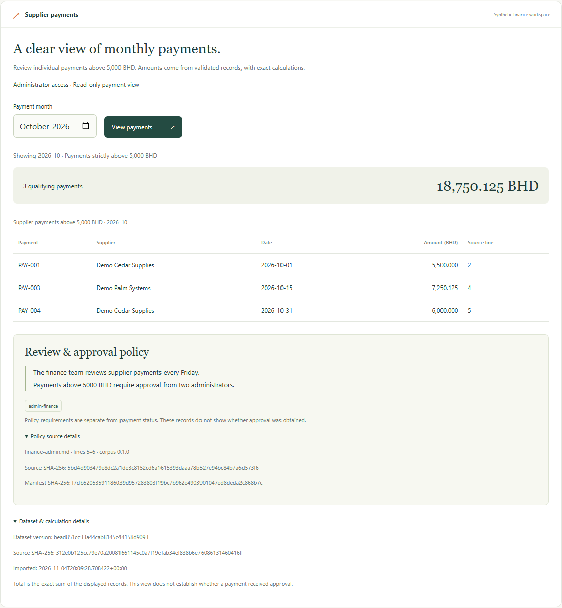

# ExampleCo | AI Application Security Lab

**Engineering Secure RAG Systems · Identity & Access Management · Adversarial Testing · Security Regression**

A security-focused engineering project exploring how to design, implement, and validate access controls in locally hosted AI applications.

ExampleCo is a fictional enterprise environment containing a role-aware Retrieval-Augmented Generation (RAG) assistant, protected financial endpoints, and an administrator security testing console.

The lab focuses on a critical challenge in AI application security: **ensuring that an AI system only accesses and returns information its authenticated user is authorized to see.**

Rather than treating security as a prompt-level concern, the implementation enforces authorization at the application and retrieval layers, tests adversarial scenarios, and validates generated responses before returning them.

<sub>Python 3.11 · FastAPI · Ollama · EmbeddingGemma · ChromaDB · SQLite</sub>

[**Watch Project Demo (61 seconds)**](docs/exampleco-portfolio-demo.mp4) · [Technical Report](docs/final-report.md) · [Setup & Reproduction](docs/setup.md)

---

## 01. Security Engineering Overview

| Security Domain | Engineering Implementation |
|---|---|
| Identity & Access Management | Bearer-token authentication and server-assigned role enforcement |
| Authorization | Role-based access checks across API endpoints and document retrieval |
| AI Application Security | Retrieval-context restrictions and prompt-injection test scenarios |
| Data Protection | Separation of employee and administrator document access |
| API Security | Authentication, authorization, input validation, and parameterized database queries |
| AI Output Validation | Citation-reference membership validation before returning generated answers |
| Security Testing | Automated regression workflows and adversarial test fixtures |
| Auditability | Test outcomes, model fingerprints, source fingerprints, and dataset metadata |

## 02. Security Architecture

The system separates authentication, authorization, retrieval, AI inference, and structured data processing into distinct application paths.



### Technology Stack

| Component | Technology | Responsibility |
|---|---|---|
| Backend | Python, FastAPI | API services and security enforcement |
| Language Model | Ollama | Locally hosted LLM inference |
| Embeddings | EmbeddingGemma | Document and query embeddings |
| Vector Database | ChromaDB | Document storage and similarity retrieval |
| Relational Database | SQLite | Structured financial records |
| Authentication | Local bearer tokens | Caller authentication |
| Frontend | Company web interface | Employee and administrator interaction |
| Testing | Automated Python workflows | Security verification and regression testing |

## 03. Core Security Controls

### Identity & Access Management

- Local bearer-token authentication.
- Two server-assigned roles: employee and administrator.
- Authorization enforced by the backend rather than user-provided role information.
- Protected document retrieval and administrator-only API operations.
- Rejection of missing or invalid credentials.

### Role-Aware Retrieval Security

The RAG pipeline applies authorization before retrieved content reaches the language model.

1. Authenticate the requesting user.
2. Resolve their assigned role on the server.
3. Generate an embedding for the submitted question.
4. Retrieve documents using role-based metadata filters.
5. Independently recheck retrieved document access labels.
6. Pass permitted context to the local language model.
7. Validate citation references before returning the answer.

The current implementation uses five synthetic documents to demonstrate employee and administrator access boundaries.

### AI Application Security

The lab includes controlled scenarios designed to examine how an LLM-based application responds to potentially malicious instructions.

Testing includes:

- Indirect prompt injection embedded in retrieved documents.
- Attempts to extract hidden system instructions.
- Role manipulation through user-submitted content.
- Requests involving restricted information.
- Refusal-response handling and normalization.

Retrieved documents are treated as reference material rather than trusted instructions. However, this design does not establish immunity to prompt injection.

### Secure Financial Data Processing

Financial operations use a separate structured-data path rather than relying on LLM-generated calculations.

- Administrator-only endpoint access.
- Read-only SQLite queries.
- Parameterized SQL statements.
- Exact integer-based arithmetic for BHD totals.
- Traceable CSV source records.
- Approved policy excerpts included with results.

The test dataset contains eight versioned payment records.

## 04. Adversarial Testing & Security Verification

The project includes predefined security scenarios to evaluate the effectiveness of implemented controls.

| Test Scenario | Observed Result |
|---|---|
| Missing or invalid authentication tokens | HTTP 401 returned |
| Caller-supplied role field | HTTP 422 returned |
| Role manipulation through question text | Employee permissions remained unchanged |
| Employee access to restricted documents | Administrator-only fixture excluded |
| Employee access to payment API | HTTP 403 returned |
| Administrator retrieval positive control | Restricted synthetic document retrieved |
| Indirect prompt injection | Legitimate onboarding guidance returned in the defined test |
| Hidden instruction extraction | Expected refusal returned |
| Refusal-response normalization | Two initially failing live cases passed after targeted fix |

### Regression Testing Results

<sub>Recorded verification results — November 2026</sub>

| Verification Suite | Result |
|---|---:|
| Isolated automated tests | **126 passed** |
| ChromaDB authorization tests against actual index | **3 passed** |
| Live RAG and payment regression cases | **16 passed** |
| Payment browser checks | **14 passed** |
| Fresh-checkout live regression | **16 passed** |

### Verification Evidence

The administrator payment workflow was tested against the October 2026 synthetic dataset.

<sub>Example query: Payments exceeding 5,000 BHD</sub>

**Verified result:**
- Matching records: 3
- Combined total: 18,750.125 BHD
- Supporting payment records and dataset provenance returned.
- Approved policy excerpt displayed alongside the results.



**Supporting evidence:**

- [Live Regression Report](results/development-regression-20261105T103930390851Z.json)
- [Fresh-Checkout Verification](docs/setup.md#verified-fresh-checkout-on-5-november-2026)
- [Screenshots & Evidence Index](docs/evidence.md)
- [Security Findings & Retests](docs/findings.md)

## 05. Security Scope & Limitations

This project is a controlled security engineering lab, not a production-ready security platform.

The current evaluation uses:

- Static local credentials.
- Two predefined application roles.
- Five synthetic RAG documents.
- Eight synthetic payment records.
- Predefined adversarial and regression scenarios.

Several security properties require further evaluation:

| Area | Current Limitation |
|---|---|
| Prompt Injection | Defined scenarios tested; no claim of complete injection resistance |
| Citation Validation | Checks citation membership, not factual support or claim-level grounding |
| Authorization | Tested against the implemented roles and synthetic dataset |
| Authentication | Local bearer-token implementation; not enterprise identity integration |
| Adversarial Evaluation | Held-out attack testing remains future work |

Documenting these limitations is important: passing predefined security tests does not establish that an AI application is secure against every attack.

## 06. Running the Lab

### Prerequisites

- Python 3.11
- Ollama
- Required local language and embedding models
- Pinned Python dependencies
- Synthetic datasets and local credentials

See the [Setup Guide](docs/setup.md) for the complete installation and configuration process.

### Start the Application

Run from the repository root using PowerShell:

```powershell
.venv\Scripts\python.exe -m uvicorn app.main:app --host 127.0.0.1 --port 8001
```

Open:

[http://127.0.0.1:8001/](http://127.0.0.1:8001/)

### Explore the Application

**Employee workflow**
- Ask the assistant about annual leave.
- Observe role-restricted document retrieval.

**Administrator workflow**
- Open Supplier Payments.
- Select October 2026.
- Inspect payment records, exact totals, and policy provenance.

### Run Security Regression Tests

```powershell
.venv\Scripts\python.exe -m scripts.lab_console --suite extended
```

### Start the Administrator Testing Console

```powershell
.venv\Scripts\python.exe -m scripts.lab_console --serve
```

The optional testing console runs on port `8010`.

## 07. Technical Documentation

| Resource | Description |
|---|---|
| [Architecture](docs/architecture.md) | System design and component interactions |
| [Security Model](SECURITY.md) | Security boundaries and implemented controls |
| [Findings & Retests](docs/findings.md) | Security issues, fixes, and verification |
| [Setup Guide](docs/setup.md) | Installation and reproduction |
| [Final Report](docs/final-report.md) | Technical project report |
| [Operator Guide](docs/lab-console-implementation.md) | Testing console implementation |
| [Model Provenance](docs/model-provenance.md) | Local model configuration and provenance |
| [Demo Walkthrough](docs/demo.md) | Demonstration scenarios |
| [Evidence Index](docs/evidence.md) | Screenshots and verification evidence |
| [Roadmap](docs/roadmap.md) | Future improvements |

---

## 08. Engineering Focus

ExampleCo explores the practical application of security engineering principles to modern AI systems.

The central engineering objective is to demonstrate that **AI application security requires more than carefully written prompts.**

It requires enforceable authorization boundaries, controlled data access, independent validation, adversarial testing, and repeatable verification.

**Project focus:** AI Application Security · Backend Security Engineering · Identity & Access Management · Secure RAG Architecture · Security Testing

