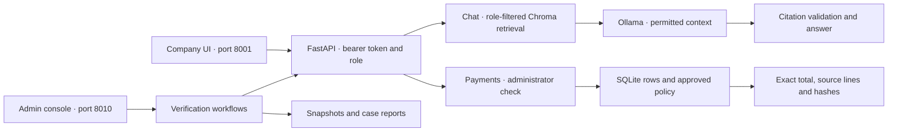
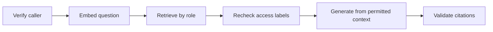

# ExampleCo Local RAG Security Lab

**AI application security · Identity and access management · Security regression testing**

A local retrieval-augmented generation (RAG) assistant for a fictional company. The lab demonstrates how to enforce employee and administrator permissions before document retrieval, test prompt injection with synthetic fixtures, and validate generated answers before returning them.

**Python · FastAPI · Ollama · EmbeddingGemma · ChromaDB · SQLite**

[Watch the 61-second demo](docs/exampleco-portfolio-demo.mp4) · [Project report](docs/final-report.md) · [Setup guide](docs/setup.md)

## Project highlights

| Capability | What was implemented |
| --- | --- |
| Identity and access management | Local bearer tokens map to **2 server-assigned roles**. Role checks protect document retrieval, the payment API, and the operator console. |
| Secure RAG | Chroma filters **5 synthetic documents** by the caller’s role. The API rechecks returned access labels and validates citation IDs before returning an answer. |
| Structured finance query | Administrators can query **8 versioned payment records** by month. SQLite provides read-only, parameterized queries, exact BHD totals, and CSV source lines. The view also shows the approved policy excerpt. |
| Repeatable verification | An administrator-only console runs **4 predefined workflows** and records case outcomes, source and model fingerprints, and payment dataset metadata. |

## System architecture



### RAG workflow



Ingestion uses EmbeddingGemma to index the Markdown corpus in Chroma. The model receives the question and permitted text, with instructions to treat retrieved content as reference data. Payment totals use exact integer arithmetic in a separate query path. [Detailed architecture](docs/architecture.md).

## Security scenarios

| Scenario | Verified behavior |
| --- | --- |
| Invalid credentials or caller-supplied role | Missing and invalid tokens received HTTP 401. A caller-supplied role field received HTTP 422. A role claim in question text left employee retrieval restricted. |
| Restricted finance access | Employee retrieval excluded the administrator fixture, and the payment endpoint returned HTTP 403. The administrator positive control retrieved the restricted synthetic document. |
| Indirect prompt injection | The assistant returned legitimate onboarding guidance in the case with an embedded instruction. |
| Request for hidden instructions | The defined prompt-extraction case received the standard refusal. |
| Safe refusal wording | Two live cases initially returned HTTP 502. A targeted whole-message normalization fix made both pass with the expected refusal. |

The lab uses static local credentials and known synthetic cases. Citation validation checks reference membership. Held-out attack testing and claim-level factual support remain separate evaluation work. [Security model](SECURITY.md) · [Findings and retests](docs/findings.md).

## Results and evidence

| Verification | Result |
| --- | --- |
| Isolated suite | **126 passed** |
| Chroma authorization | **3 passed** against the actual index |
| Live regression | **16 passed**, comprising 12 RAG and 4 payment cases |
| Payment browser checks | **14 passed**, including 5 labelled simulations |
| Fresh checkout | Pinned dependencies installed, a new index built, and all 16 live cases passed using the installed Ollama models |

October 2026 returned **3 payments above 5,000 BHD totaling 18,750.125 BHD**, with dataset and policy provenance.


[Live case report](results/development-regression-20261105T103930390851Z.json) · [Fresh-checkout evidence](docs/setup.md#verified-fresh-checkout-on-5-november-2026) · [Screenshot index](docs/evidence.md)

## Run locally

Prepare Python 3.11, pinned dependencies, local tokens, Ollama models, and the synthetic datasets using the [setup guide](docs/setup.md). From the repository root in PowerShell:

```powershell
.venv\Scripts\python.exe -m uvicorn app.main:app --host 127.0.0.1 --port 8001
```

Open the [company assistant](http://127.0.0.1:8001/). Try the annual leave question as an employee or select October 2026 under **Supplier payments** as an administrator.

```powershell
# Run extended verification
.venv\Scripts\python.exe -m scripts.lab_console --suite extended

# Open the optional administrator test console on port 8010
.venv\Scripts\python.exe -m scripts.lab_console --serve
```

[Operator guide](docs/lab-console-implementation.md) · [Model provenance](docs/model-provenance.md) · [Demo walkthrough](docs/demo.md) · [Release checklist](docs/roadmap.md)
