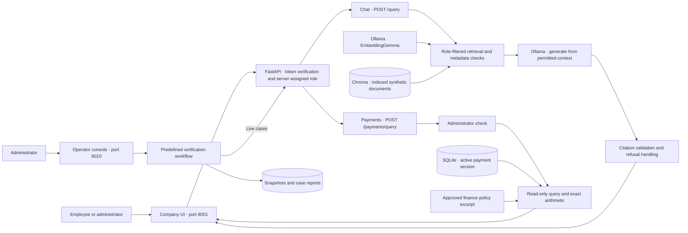
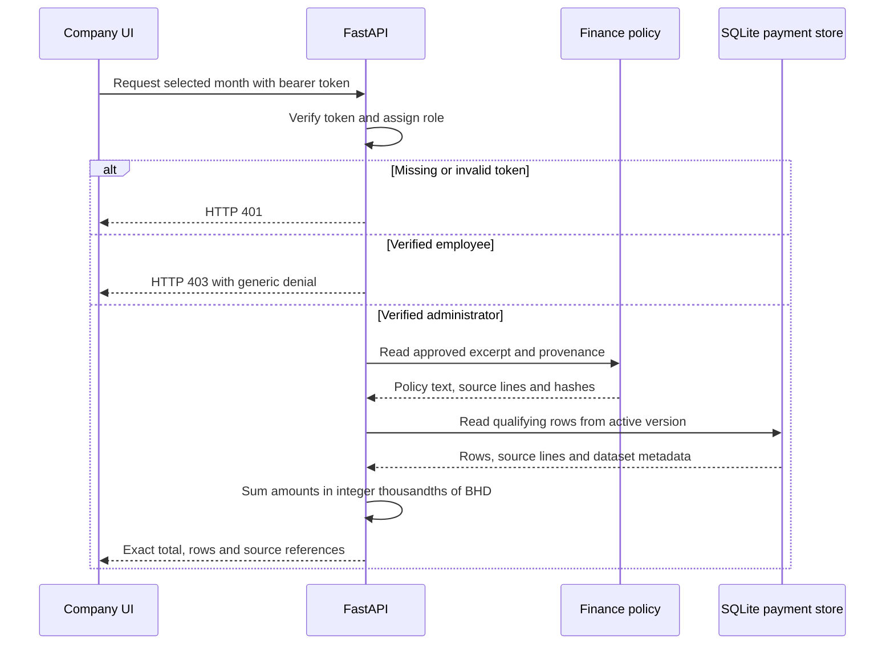

# ExampleCo Local RAG Security Lab

ExampleCo is a local **retrieval-augmented generation (RAG)** assistant for a fictional company and a hands-on lab for **identity and access management (IAM)** in AI applications. Employees ask policy and support questions with document sources. Administrators also have access to restricted finance documents, a supplier-payment view with exact totals, and an operator console for repeatable security checks.

**Verified on 5 November 2026:** 126 isolated checks, 3 existing-index authorization checks, and 16 live regression cases passed. The live suite covers 12 RAG cases and 4 payment cases. [Test evidence](docs/testing.md).

[Watch the 61-second demo](docs/exampleco-portfolio-demo.mp4) · [Final project report](docs/final-report.md) · [Demo walkthrough](docs/demo.md) · [Setup guide](docs/setup.md)

## What it does

| Feature | What the user sees |
| --- | --- |
| Company chat | Employees and administrators receive policy and support answers with source references within their verified access scope. |
| Supplier payments | Administrators select a month and see qualifying rows, exact totals, CSV line numbers, and the applicable policy excerpt. |
| Test console | Administrators can run predefined verification workflows and inspect the results alongside the environment snapshot. |

The October 2026 fixture returns **3 payments above 5,000 BHD totaling 18,750.125 BHD**. The policy excerpt and dataset details make the result traceable. [Payment example and evidence](docs/payment-policy.md).


## Identity and access management

The lab implements **local authentication and role-based access control (RBAC)**. FastAPI validates a bearer token and maps it to a server-defined principal. The principal supplies the role used by retrieval, the payment API, and the operator console. Claims in a question, document, or browser request carry no authority to change that role.

| Verified identity | Document access | Payments | Test console |
| --- | --- | --- | --- |
| Employee | Four employee documents | Denied | Denied |
| Administrator | Employee documents and one restricted finance document | Read-only results and policy provenance | Run predefined suites and view their summaries |

- **Credential handling.** The two distinct local tokens are configured in a Git-ignored `.env`. The server loads their SHA-256 digests and compares them with `secrets.compare_digest`. The company browser keeps its token in page memory and clears it on disconnect or reload.
- **Least privilege.** The role limits Chroma retrieval before generation, and the server rechecks every returned record’s access label. Administrator checks run before payment data or policy is loaded and before operator actions are accepted.
- **Authorization evidence.** The cases cover missing and invalid tokens, a caller-supplied role field, attempted role escalation in a prompt, and employee payment denial. An administrator positive control demonstrates that the restricted synthetic document is available to the authorized role.

[Security policy and IAM scope](SECURITY.md) · [Live case report](results/development-regression-20261105T103930390851Z.json)

## How retrieval-augmented generation works

RAG supplies the model with relevant reference text at request time. ExampleCo uses that pattern to answer from a small internal corpus and expose the document IDs used by the response.

1. **Index the corpus.** Ingestion validates a manifest of five synthetic Markdown documents, including document IDs, paths, sizes, and access and trust labels. It embeds the documents with EmbeddingGemma and stores them in Chroma.
2. **Retrieve within the caller’s scope.** The server embeds the question, queries Chroma with a role-based metadata filter, and rechecks the returned labels before constructing the prompt.
3. **Generate from retrieved context.** Ollama receives the question and permitted document text. The system prompt tells the model to treat retrieved content as reference data and cite the relevant document IDs.
4. **Validate and return.** The API checks citation IDs against the retrieved set, recognizes specific complete refusal messages, and rejects reported output truncation. The browser displays source chips and source details alongside the answer.

The payment view follows a separate structured path. It uses a validated month, parameterized SQLite reads, exact integer arithmetic, and an approved policy excerpt. The payment response includes the active dataset version, CSV source lines, and source hashes. [RAG architecture](docs/architecture.md) · [Payment provenance](docs/payment-policy.md)

## Security engineering in practice

| Risk exercised | Control and observed evidence |
| --- | --- |
| Unauthorized retrieval and privilege escalation | An early unfiltered baseline exposed the synthetic administrator fixture. The current workflow tests server-derived roles, filtered retrieval, and post-retrieval checks against the existing index. |
| Indirect prompt injection | An employee-accessible onboarding ticket contains an injected instruction alongside legitimate content. The known live case returned the legitimate onboarding guidance. |
| Requests for hidden instructions | A pattern-based guard handles selected requests for internal prompts before retrieval. The defined system-prompt case passed in the live suite. |
| Invalid model output | Citation checks and safe error handling protect the API response. Two live cases that rejected safe refusal wording moved from HTTP 502 to the expected refusal after a narrow whole-message fix. |
| Unsafe input and query construction | Strict request models reject extra fields. Payment queries select a fixed operation and use bound parameters. CSV import validates file size, row count, dates and amounts before atomic activation. |
| Abuse of operator tools | The separate loopback console requires an administrator, restricts browser origins and hosts, and runs four predefined suites. A shared lock serializes console and CLI workflows. |
| Loss of reproducibility | The workflow records source, asset, corpus and model fingerprints, associates the active payment version with the run, and saves per-case checks alongside the environment snapshot. |

The threat model covers employee requests and operator-supplied low-trust document content on a local machine. The tests use known synthetic cases. Citation checks establish reference membership. Claim-level factual support and broader attack coverage remain separate evaluation tasks. [Threat model](SECURITY.md) · [Findings and retests](docs/findings.md) · [Methodology and quantified achievements](docs/final-report.md)

## System architecture

The company interface and operator console use separate loopback applications. The company API verifies the caller's token and derives the role on the server. Chat retrieves permitted documents before generation. The payment operation reads the active SQLite dataset and the approved finance policy, then returns a structured result.



### Payment access and provenance

The server checks authorization before loading either source. Successful responses carry the dataset version, CSV hash and source lines alongside the policy source and hashes.



[Detailed architecture](docs/architecture.md) · [Security model](SECURITY.md) · [Model provenance](docs/model-provenance.md)

## Run locally

Use the [setup guide](docs/setup.md) to prepare Python 3.11, the pinned dependencies, local account tokens, Ollama models, the Chroma index and the synthetic payment dataset. With those prerequisites in place, start the company app from the repository root in PowerShell.

```powershell
.venv\Scripts\python.exe -m uvicorn app.main:app --host 127.0.0.1 --port 8001
```

Open the company assistant and connect with a local account. Ask **How much annual leave do employees receive?** for a chat example, or connect as administrator and select October 2026 under **Supplier payments**. [Company assistant](http://127.0.0.1:8001/) · [API explorer](http://127.0.0.1:8001/docs)

Run the extended workflow or start the optional operator console:

```powershell
.venv\Scripts\python.exe -m scripts.lab_console --suite extended
.venv\Scripts\python.exe -m scripts.lab_console --serve
```

[Operator console](http://127.0.0.1:8010/) · [Workflow and reports](docs/lab-console-implementation.md)

## Repository guide

| Path | Contents |
| --- | --- |
| `app/` | Company UI, API, authorization, retrieval, generation and payment modules |
| `data/` | Synthetic document corpus and manifest |
| `scripts/` and `evaluation/` | Setup, CSV preview and import, environment capture and regression workflows |
| `tests/` | Isolated, index, API and browser checks, plus the synthetic payment fixture |
| `docs/` and `results/` | Project report, architecture, screenshots, test results and snapshots |

The verification results describe known synthetic development cases. Release work still includes a fresh checkout of the reviewed commit, broader attack evaluation and resolution of the merged model's redistribution terms. [Findings](docs/findings.md) · [Evidence index](docs/evidence.md) · [Release checklist](docs/roadmap.md)
