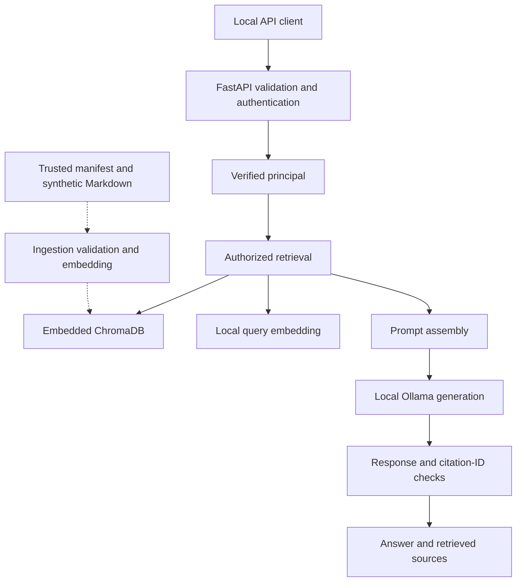

# Architecture and trust boundaries

The payment operation now calls `app.payment_policy` after administrator authorization, reading the existing curated finance paragraph and returning exact source/manifest hashes and line provenance alongside the deterministic result. Missing/changed expected policy fails closed with 503. The frontend displays the excerpt as text with expandable source details. No model-generated explanation or approval-status inference is involved. See [the policy adapter guide](payment-policy.md).

This page covers the original RAG design and subsequent operator and payment additions. The [final report](final-report.md) summarizes the current verified state.

## Structured payment operation added on 4 November 2026

`app.payment_api` adds administrator-only `POST /payments/query` to the company API. It validates the approved operation and calendar month, authorizes before storage access, then calls `app.payment_store` for a consistent read-only SQLite snapshot. Exact integer arithmetic produces the rows/count/total and version/hash/line provenance. `data/payments.sqlite3` is independent of Chroma and the original corpus; local activation is transactional and retains historical versions. No model or policy explanation is involved. See [the feature contract](supplier-payments-contract.md).

The subsequent payment frontend below the chat now consumes this structured operation. It gates controls by the verified role, renders supplier data as text, validates exact row totals and clears results on account/month changes or New conversation. Server-side authorization remains authoritative. Request cancellation and a generation counter prevent delayed responses from restoring finance results after disconnect. [Interface evidence](payment-ui.md) includes separate real-browser checks and labelled response simulations. Natural-language routing and policy explanations remain future work.

## Operator tooling added on 4 November 2026

The company assistant remains on port 8001. The administrator-only lab console is a separate FastAPI application on loopback port 8010; it does not add test execution endpoints to the employee assistant.

`scripts/lab_console.py` provides the CLI and launcher. `scripts/lab_workflow.py` is shared orchestration for fixed modules, readiness, the cross-process lock, bounded subprocess stages and persistent evidence. `scripts/lab_console_web.py` authenticates administrator requests, applies same-origin/Host restrictions and serves curated run summaries. Browser assets live in `scripts/console_static/` and are included in environment hashes alongside `app/static/`.

The HTTP start action dispatches a background thread. The browser polls stage progress, then receives actual evaluator case counts, failed checks and timings. The original evaluator writes its complete synthetic case report; the orchestration record links that report to its captured environment. Logs and arbitrary filesystem paths are not exposed. An interrupted report is recovered when its process lock is no longer held.

The launcher's companion API lifecycle is ownership-based: reuse an existing port-8001 listener; start a thread-owned API only when the port is free; stop only that companion on launcher exit. Ollama startup and model installation are prerequisites. The sections below retain the earlier application architecture.

## Request and ingestion flow

Ollama provides both embeddings and generation using separate models. Authorized retrieval obtains candidate IDs and queries with the same access filter. The response stage checks nonempty output, reported truncation and citation-ID membership. It also canonicalizes recognized complete no-answer messages. It is not a factual-support evaluator or a complete guardrail service.

## Modules

| File | Responsibility |
| --- | --- |
| `app/main.py` | FastAPI routes, request/response schemas, dependencies and selected error handling |
| `app/auth.py` | Load local account credentials and map bearer tokens to a frozen `Principal` |
| `scripts/setup_tokens.py` | Generate different employee/admin tokens without overwriting `.env` |
| `app/ingest.py` | Validate the manifest and corpus, generate embeddings and upsert Chroma |
| `app/retrieve.py` | Query embeddings, role-based metadata filters and a post-retrieval permission check |
| `app/rag.py` | Retrieve permitted content, assemble the prompt and call local generation |
| `tests/live/check_auth.py` | HTTP checks for missing, invalid, employee and administrator credentials |
| `app/output_validation.py` | Citation parsing, permitted-ID checks and exact complete refusal normalization |
| `tests/isolated/check_output_validation.py` | Function-level output validation cases |
| `tests/isolated/check_query_output.py` | Route-to-validator integration using simulated retrieval and model output |
| `tests/isolated/check_authorization.py` | Eight deterministic role and post-retrieval policy tests |
| `tests/live/check_chroma_authorization.py` | Actual-index baseline, employee and administrator retrieval checks |
| `evaluation/run_regression.py` | Separately available live development runner; execution report not reviewed here |

The shared project uses root-level modules. An `app/` package and separate policy/guardrail modules remain possible refactoring work, not an implemented layout.

## API contracts

| Route | Authentication in shared code | Behavior |
| --- | --- | --- |
| `GET /health` | Not required | Returns a simple application status; does not establish model or DB readiness |
| `GET /whoami` | Required | Returns verified `user_id` and `role` |
| `POST /generate` | Required | Sends a validated prompt to the local generation model |
| `POST /query` | Required | Uses verified identity for retrieval and returns an answer and sources |

The latest `/query` handler explicitly receives `principal = Depends(get_principal)` and passes it into `answer_question(question, principal)`. Authentication alone was an earlier intermediate state and did not restrict retrieval by itself.

## Identity boundary

`app/auth.py` reads `.env` relative to the module path at import time. Each configured token is SHA-256 hashed in memory and supplied credentials are compared with `compare_digest`. Tokens must be nonempty, at least 32 characters long and different from one another.

The plaintext tokens still exist in `.env`. This is static bearer-token authentication, not OAuth, JWT, encrypted credential storage, token expiry or a multiuser account-management service. The server assigns the role; request content does not.

## Document access boundary

| Verified role | Permitted `access_level` values |
| --- | --- |
| employee | employee |
| admin | employee, admin |
| unknown | retrieval rejects with `PermissionError` |

`retrieve_authorized` builds a Chroma `where` constraint from that mapping. It also checks returned access labels before content reaches generation. Unknown/missing labels are not intentionally allowed by this policy. Eight tests now exercise filter construction, forbidden admin records, missing/invalid labels, absent metadata and an unknown role. Three additional checks use the actual Chroma index. These cases do not cover every malformed object or future read path.

`retrieve_unfiltered` remains for explicit local baseline experiments. Its CLI requires `--baseline`. The shared API route calls the authorized function; no caller-selectable API mode is implemented.

## Manifest and ingestion boundary

The manifest is trusted operator configuration under the experiment's threat model. Each document carries `document_id`, `source`, `access_level`, `trust_level`, `dataset_version` and a SHA-256 content hash in the index.

The shared ingestion code validates duplicate/nonempty IDs, allowed access and trust labels, direct Markdown children of the corpus folder, nonempty text and a 20,000-byte size limit. It checks embedding counts and collection model compatibility, and refuses to silently leave documents outside the current manifest.

Documents are embedded as whole records in this initial implementation. A chunking pipeline is not shown. Manifest schema edge cases, race conditions and malicious host-side file changes have not been fully tested.

## Content trust boundary

`access_level` answers who may retrieve a document. `trust_level` records provenance classification. An employee-accessible support ticket can still contain a prompt injection.

The current RAG context contains document ID and text. Trust metadata is stored but is not a deterministic quarantine or content-filter decision, and the current API source objects do not expose that label. Curated content also cannot grant authority to change the assistant's instructions.

The active hardened system prompt explicitly directs the model to treat retrieved text as reference data and ignore instructions addressed to the assistant. Its mode was confirmed after restarting the actual listener. The onboarding payload and a normal leave question then produced the expected live answers. This is one tested payload, not general injection protection.

## Output boundary

The RAG response includes `mode`, `model`, `answer` and retrieved `sources`. Source objects contain `document_id`, `source` and `access_level`.

Implemented response checks require nonempty text and reject output that reports `done_reason: length`. The client has a 180-second HTTP timeout per Ollama call. Stop sequences were added for `<eos>` and `<end_of_turn>` after visible output artifacts.

The source list is retrieval provenance. It is not proof that every source supports every claim. `validate_citations` checks bracket syntax, requires at least one citation for ordinary answers, and rejects IDs outside the permitted retrieved set. It is invoked before returning the answer; `CitationValidationError` is a `ValueError` mapped to a generic 502 by the route. A complete recognized refusal is returned as the canonical no-answer message without requiring a citation. Factual support, per-sentence citation coverage and universal secret redaction are not enforced by this validator. Prompt-extraction protection has not been established by the evidence reviewed here.

## Local host boundary

FastAPI and Ollama are used on loopback, with Chroma embedded rather than exposed as a separate service. The lab assumes an attacker cannot read `.env`, edit trusted manifests or modify backend code. A process that can directly call Ollama bypasses FastAPI's authentication; application tokens do not protect the whole host.

## Output-validation boundary tests

The four API integration cases run the actual FastAPI handler and output validator with an employee credential loaded locally. Retrieval results and Ollama responses are simulated. Valid citations and the canonical no-answer message return 200; missing citations and out-of-set references return 502. An initial 2/4 result was corrected by wiring the validator into `rag.answer_question`.

The later 502 on a live employee marker question had a different cause: a legitimate paraphrased refusal failed the exact canonical-message exception. The observed complete wording was added to a full-message normalization set. Whitespace and case are normalized, and the result is replaced with the canonical message. A refusal followed by an uncited factual claim does not qualify for that exception. Unseen refusal variants can still be rejected.

The separate Chroma integration test reads the stored `admin-finance` vector and supplies it to the embedding adapter. Database calls and the application's retrieval functions remain real. A direct local seed read is a privileged test fixture operation; it is not an API route available to an employee.
