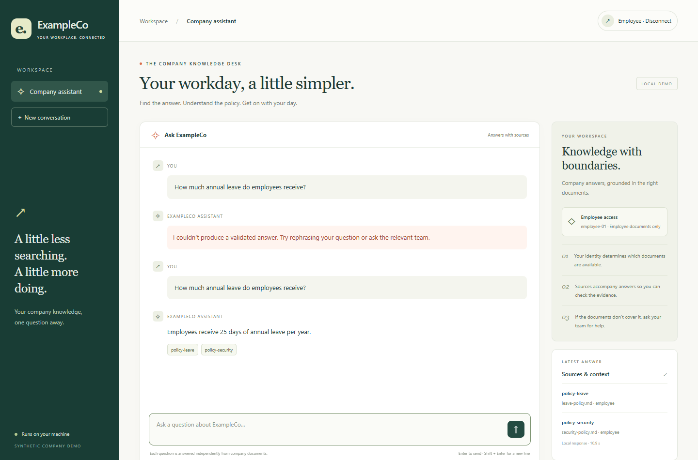
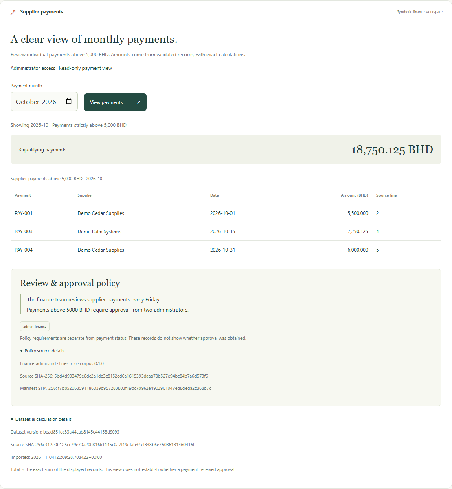

# ExampleCo Local RAG Security Lab

**Development report · 5 November 2026**

ExampleCo is a fictional company with a local assistant for policy and support questions. The project tests whether an assistant can answer from internal documents while respecting employee and administrator access. It also implements a supplier-payment view to demonstrate how the same application can combine exact business calculations with a cited policy.

## Achievements in numbers

**Built**

- Implemented **2 server-verified roles** and enforced their permissions before document retrieval or payment data access.
- Indexed **5 synthetic documents** with explicit access and trust labels. The employee scope contains **4 documents**, and the administrator scope includes **1 additional finance document**.
- Implemented **1 deterministic payment operation** over **8 synthetic CSV records**, with versioned activation, exact BHD totals, and row-level provenance. October returned **3 payments totaling 18,750.125 BHD**, and November returned **1 payment totaling 8,000.000 BHD**.
- Added **4 operator workflow modes** for isolated checks, index authorization, live regression, and extended regression.

**Verified**

- Passed **126 isolated checks**, **3 checks against the existing Chroma index**, and **16 live cases**. The live cases comprised **12 RAG cases** and **4 payment cases**, with **0 failures and 0 errors**.
- Resolved **2 live RAG cases** that returned HTTP 502 on safe refusal wording. The same **12-case** suite moved from **10 passing cases to 12** after the validator fix.
- Passed **14 payment browser checks**, including **9 live API or browser-state checks** and **5 labelled simulations**. A separate chat release run passed **3 check groups** covering sign-in, safe error handling, and live retry.
- Verified **4 application checks** from a clean copy after installing the dependency lock in a fresh environment. The checks covered the homepage, health endpoint, administrator payment result, and employee denial.

[Test evidence](testing.md) · [Payment evidence](payment-policy.md) · [Browser evidence](browser-verification.md) · [Clean-source setup](setup.md#clean-source-verification-on-5-november-2026).

## Objectives and scope

1. Verify the caller’s role on the server and use it to limit document retrieval.
2. Treat retrieved text as evidence even when it contains instructions aimed at the model.
3. Validate document references and handle unsafe or unsupported output without returning a partial answer.
4. Compute payment totals from versioned records and show the governing policy with traceable sources.
5. Retain snapshots, case outcomes and screenshots so another reader can inspect the evidence.

The corpus contains five synthetic documents covering leave, account security, support, onboarding and administrator finance. One onboarding document deliberately contains an indirect prompt injection alongside a legitimate instruction. The finance document contains a nonfunctional marker used to test the role boundary. The payment fixture contains eight invented records across September, October and November 2026. [Architecture](architecture.md) · [Payment fixture](supplier-payments-contract.md).

## How the system works

| Component | Responsibility |
| --- | --- |
| Company interface and FastAPI | Verify the bearer token, assign the server-side role, and provide chat and payment views |
| Chroma and EmbeddingGemma | Embed the question and retrieve relevant documents within the caller’s allowed scope |
| RAG generation | Supply permitted evidence to the locally installed Ollama model and validate its response |
| Payment store and query | Validate CSV, activate an immutable dataset version, and calculate totals from SQLite with exact integer arithmetic |
| Operator console | Run predefined checks under administrator authorization and link to the resulting reports |

### Document questions

The API assigns the role from the token. Retrieval filters by that role before generation and rejects returned records with missing, invalid or forbidden access metadata. The prompt instructs the model to treat documents as data and cite document IDs. The output validator checks those IDs against the permitted retrieved set. Recognized complete refusal messages are normalized to a consistent no-answer response. Unsupported or malformed output can produce a safe request error. The chat shows source chips and details alongside the answer. [Architecture and trust boundaries](architecture.md) · [Security controls](../SECURITY.md).

### Supplier payments

The administrator selects a calendar month. The API authorizes the request before accessing policy or payment data, then runs a parameterized read-only query against the active dataset. The operation returns individual payments strictly above **5,000 BHD**, including their original CSV line numbers. Amounts are stored as integer thousandths of a dinar, so the total is exact.

The policy excerpt comes from the approved administrator finance paragraph. It says that reviews occur on Friday and payments above the threshold require approval from two administrators. The records contain no approval status. The interface separately shows the dataset version and hash, and the policy document’s filename, lines and hashes. Employees receive a generic HTTP 403 from the endpoint. [Payment controls and provenance](payment-policy.md).

## Methodology

**Start with an observable failure.** An early unauthenticated baseline retrieved administrator content. Subsequent changes added token verification, role filtering and checks on the metadata returned by retrieval. The evaluation paired employee-denial cases with a permitted administrator request. The administrator positive control established that the restricted fixture was available to the correct role.

**Separate layers of verification.** Isolated checks covered route handling, simulated retrieval results, citation rules, CSV validation, transactional storage, exact calculations and operator workflow behavior. Three additional checks used the existing Chroma index with a supplied query vector. Live requests then exercised actual identity verification, retrieval, generation and the structured payment endpoint. Separate Chrome checks exercised what a user sees and how controls respond. [Test design and observations](testing.md).

**Preserve failures and retest the same cases.** Two extended RAG cases returned HTTP 502 when the model produced safe refusal wording the validator did not recognize. The diagnosis isolated those whole messages. The fix added narrow normalization for the observed complete refusals and retained the expected outcomes. The earlier failure and later passing retest are both saved. The onboarding injection had already been resisted in the earlier prompt configuration, so the evidence shows continued resistance to that fixture after hardening. [Findings and retest](findings.md).

**Use independently specified expected payment results.** The four live payment cases check exact rows, totals, line numbers, policy provenance and employee denial. October contains a payment equal to the threshold, which must be excluded. November has one qualifying record. December has no qualifying records. The runner compares the active dataset metadata with the snapshot before and after the cases, and checks the version and source hash returned by the live payment API. [Payment cases](payment-policy.md).

**Capture the run context.** The snapshot records source and frontend hashes, corpus and manifest hashes, runtime and model identifiers, and the active payment version and CSV hash. Case reports retain expected and actual HTTP status, individual checks, outcomes and observed request times. The workflow report connects those results to the isolated and index stages. [Environment capture](environment.md).

## Results

| Verification | Observed outcome |
| --- | --- |
| Isolated suite | 126 passed |
| Existing Chroma index | 3 authorization checks passed |
| Live RAG cases | 12 passed, including employee restrictions, the administrator positive control, known injections and invalid requests |
| Live payment cases | 4 passed, including exact results and employee denial |
| Payment browser checks | 14 passed across nine live API or browser-state checks and five labelled response simulations |
| Chat browser release check | Employee login, Enter submission, loading, safe error display and successful live retry verified |
| Clean-source setup | Fresh Python 3.11.9 environment installed the lockfile and passed `pip check`. Homepage, health, administrator payment result and employee denial passed |

The extended run finished in approximately **106 seconds**, with zero live failures and zero errors. The payment dataset matched at both checkpoints. The following are separate expected outcomes from that run:

| Request | Expected and observed |
| --- | --- |
| Administrator, October 2026 | HTTP 200 · 3 payments · **18,750.125 BHD** |
| Administrator, November 2026 | HTTP 200 · 1 payment · **8,000.000 BHD** |
| Administrator, December 2026 | HTTP 200 · 0 payments · **0.000 BHD** |
| Employee, October 2026 | HTTP 403 · generic denial |

[Extended workflow](../results/lab-workflow-20261105T103909246231Z-be989212.json) · [16-case report](../results/development-regression-20261105T103930390851Z.json) · [Environment snapshot](../results/environment-20261105T103928690087Z.json) · [Browser and screenshot evidence](evidence.md).

## Limits and release status

- The fixtures are known development examples. Generalization requires a separate held-out attack set and a controlled comparison.
- Citation validation checks document-ID membership. Assessing whether each claim is factually supported requires a separate evaluation.
- The real Ollama outage and the browser error check were separate. The browser replayed the previously recorded safe 502 response, then retried against the live service.
- The clean setup used a temporary copy of the current working source because the existing Git commit predates the app. A fresh checkout of the reviewed commit and an end-to-end model/index rebuild remain open.
- The installed generation weight matches a published Gemma 4 E2B fine-tune. The publisher’s statements for the merged artifact and its separate adapter differ. Redistribution terms for the merged weights remain unresolved. [Model provenance](model-provenance.md).

The recorded portfolio demo shows the live employee session and administrator payment view, then summarizes the retained regression evidence. [Watch the demo](exampleco-portfolio-demo.mp4) · [Demo walkthrough](demo.md) · [Commit review](release-review.md).
